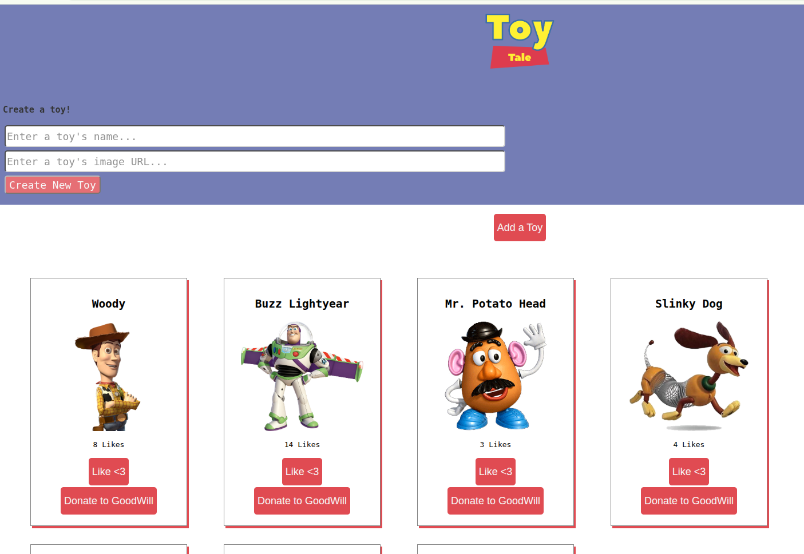

# Toy Tales

A React application for managing a collection of toys. It connects to a JSON server backend and supports full CRUD functionality: users can view, add, like, and donate (delete) toys.

## Screenshot



## Features

- **View all toys:** every toy loads from the backend when the page opens.
- **Add a toy:** click "Add a Toy", fill in a name and image URL, and submit. The new toy starts with 0 likes.
- **Like a toy:** click "Like" to increase a toy's likes by 1. The toy keeps its position on the page.
- **Donate a toy:** click "Donate to GoodWill" to delete a toy from the collection.

## How It Works

Each feature follows the same pattern: an event happens, a fetch request is made, and state is updated.

| Feature | Event | Request | State update |
|---|---|---|---|
| View toys | Page loads | `GET /toys` | Set `toys` to the response |
| Add a toy | Form submit | `POST /toys` | Append the new toy |
| Like a toy | Click Like | `PATCH /toys/:id` | Replace the updated toy in place |
| Donate a toy | Click Donate | `DELETE /toys/:id` | Filter the toy out |

All toy data lives in the `App` component's `toys` state and is passed down to child components as props.

## Component Structure

- `App`: holds the `toys` state, fetches toys on load, and defines the add, update, and delete handlers.
- `Header`: displays the page header image.
- `ToyForm`: controlled form that sends the POST request.
- `ToyContainer`: renders a `ToyCard` for each toy.
- `ToyCard`: displays one toy and sends the PATCH (like) and DELETE (donate) requests.

## Getting Started

### Prerequisites

- [Node.js](https://nodejs.org/) and npm

### Installation

```bash
git clone <your-repository-url>
cd <repository-folder>
npm install
```

### Running the App

Start the backend (runs on `http://localhost:3001`):

```bash
npm run server
```

In a second terminal, start the React app:

```bash
npm run dev
```

Then open the local URL shown in the terminal.

### Running the Tests

```bash
npm run test
```

## Tech Stack

- React
- JSON Server
- Vitest / React Testing Library

## Author

Anita